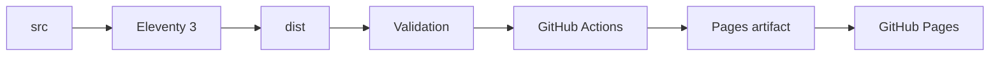
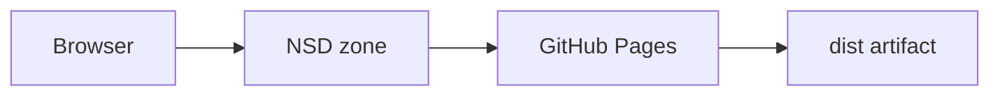

# Architecture

## Build Flow

The site is a static Eleventy project. Source lives in `src/`; generated files live in `dist/` and are never edited directly.

## Runtime Model

There is no server runtime for the website. GitHub Pages serves the static artifact produced by GitHub Actions.

Production path:

## Environment

- `SITE_URL` controls canonical URLs and sitemap output.
- `ELEVENTY_ENV=production` enables production robots behavior.
- GitHub Pages builds use `SITE_URL=https://seda.art` and `ELEVENTY_ENV=production`.

## Release Model

Each Pages deployment publishes the generated `dist/` artifact from `main`. The artifact includes `build-manifest.json` with commit, branch/tag, timestamp, Node version, environment, and `SITE_URL`.
